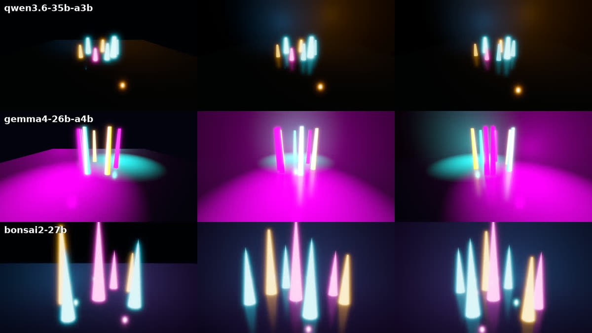

# local-studio

**Make short films and small games with AI agents, on your own machine.** Claude directs; workers (local LLMs, Claude
models, or a mix) do the work in sandboxes, driving **Godot 4**, **Unreal Engine 5**, Blender, ffmpeg and procedural
audio. Every step is planned, checked and committed, and the director reviews before anything is accepted.


*The same Godot brief ("neon crystals at night, slow orbit") made by three local models in a capability test.*

- **Two engines.** Godot 4 for 2D/3D games and stylised clips (web, Linux and Windows exports, checked headless);
  Unreal Engine 5 for photoreal cinematics and C++ games (Movie Render Queue, ray tracing).
- **Your choice of models.** Fully local (llama.cpp via llama-swap, profiles from 8 GB to 24 GB of VRAM), fully online
  (Claude models through your own login or API key), or mixed: Claude directs, local models do the bulk.
- **Measured, not guessed.** A capability suite with graders validated against reference solutions decides which
  model does what. The results and the reasoning are in [docs/models.md](docs/models.md).
- **Sandboxed workers.** Workers see only their project folder, have no network beyond the model endpoint, and reach
  GPUs and engines only through a broker that runs a fixed set of vetted actions.

## How it works


You give the director a brief, or a one-line idea that `/grill-me` turns into one by interviewing you. The director
plans small steps, each with a mechanical check, and hands each step to a sandboxed worker. The worker edits the
project and asks the broker for engine and GPU jobs. The director re-runs the checks, reads the diff, looks at the
frames, and only then commits. The whole loop, the per-step handover and how models get picked:
[workflow](docs/workflow.md), [architecture](docs/architecture.md), [evals](docs/evals.md).

The director is the `/studio` skill ([skill/studio/SKILL.md](skill/studio/SKILL.md)). Workers read a guide per
engine (`template/AGENTS.md`, `template/AGENTS-godot.md`) and use tested helpers instead of hand-written geometry.
Games get an `--autopilot` mode that plays itself and logs `GAME_` markers, so a packaged build can be tested end to end.

## Quickstart

Requirements: Linux, Python 3.10+, [Claude Code](https://claude.com/claude-code), bubblewrap, socat, ffmpeg; for
local models an NVIDIA GPU (8 GB+), the CUDA toolkit, cmake and ninja (llama.cpp is built from source); optional:
Blender, Unreal Engine 5.x.

```sh
git clone https://github.com/hennie42/local-studio && cd local-studio
./install.sh --dry-run          # shows what it would do: detected GPUs, suggested profile, files it writes
./install.sh                    # or: ./install.sh --profile online   (no local models)
studio-config                   # where everything lives
```

Then, in Claude Code (optionally start with `/grill-me <idea>` to turn an idea into a brief, see
[workflow](docs/workflow.md)):

```
/studio game: a small 2D platformer in Godot, keyboard and gamepad, web export
/studio 10 s neon city flythrough at night, rain, slow camera
```

| setup | how | needs |
|---|---|---|
| **online** | `./install.sh --profile online`; workers use Claude models | a Claude login or `ANTHROPIC_API_KEY`; no GPU for the LLMs |
| **mixed** (recommended with a GPU) | a local profile; direct with `claude`, workers run local models; any step can be routed to a Claude model | a GPU for the workers, Claude for the director |
| **fully local** | a local profile; run the director with `claude-local` too | a GPU with 16 GB+ for a useful director |

Godot is installed by `install.sh` (`godot-refresh`, which also keeps it updated weekly); Unreal you install
yourself, then set `STUDIO_UE_ROOT` in `~/.config/studio/studio.env`.

## What's in the repo

| path | what |
|---|---|
| `skill/studio/` | the director skill (`/studio`) and the measured routing; `skill/local-task/` delegates one task |
| `bin/` | `studio` (worker-side client), `studio-broker`, `studio-new`, `studio-worker`, `studio-ledger`, `studio-sandbox`, `studio-config`, `godot-*` tools, `ue5` |
| `lib/` | machine config (`studio_config.py`), how workers are launched and sandboxed (`studio_agents.py`) |
| `template/` | project templates: Godot (`godot-base`), Unreal (`ue-base`, `cpp-min`), worker guides |
| `godot/cookbook/` | verified Godot recipes (each compiles and passes a self-test on every new Godot release) |
| `models/` | local models: catalog, hardware profiles, config generator, llama.cpp build, downloads, `claude-local` |
| `evals/` | capability suites, graders, scorecards, the multi-model comparison clip |
| `docs/` | [workflow](docs/workflow.md), [asset library design](docs/assets-design.md), [models](docs/models.md), [architecture](docs/architecture.md), [Godot](docs/godot.md), [Unreal](docs/unreal.md), [local models](docs/local-models.md), [evals](docs/evals.md), [security](docs/security.md) |

## Limits (honest)

- Worker output is a draft: the director checks every step, and some steps (look development, creative calls) are
  usually the director's. In our productions roughly half to two thirds of the steps were done by local workers.
- Local models are weak at spatial reasoning (scales, rotations, timing a jump); the helpers and checks exist because
  of that. Expect retries.
- Tested on one machine (Linux, NVIDIA). macOS and Windows are not supported; AMD GPUs are untested.
- Long productions take hours of local compute; the GPU is shared between the model and the renderer.

## License

MIT, see [LICENSE](LICENSE). Godot, Unreal Engine, Blender, llama.cpp, llama-swap and the models have their own
licenses; this repo ships none of them (the installer downloads Godot and the open-weight models you choose).
