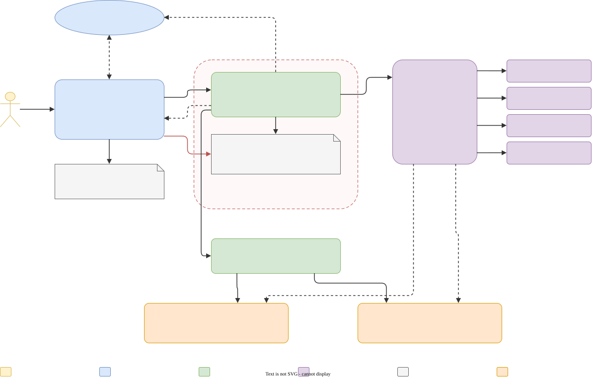
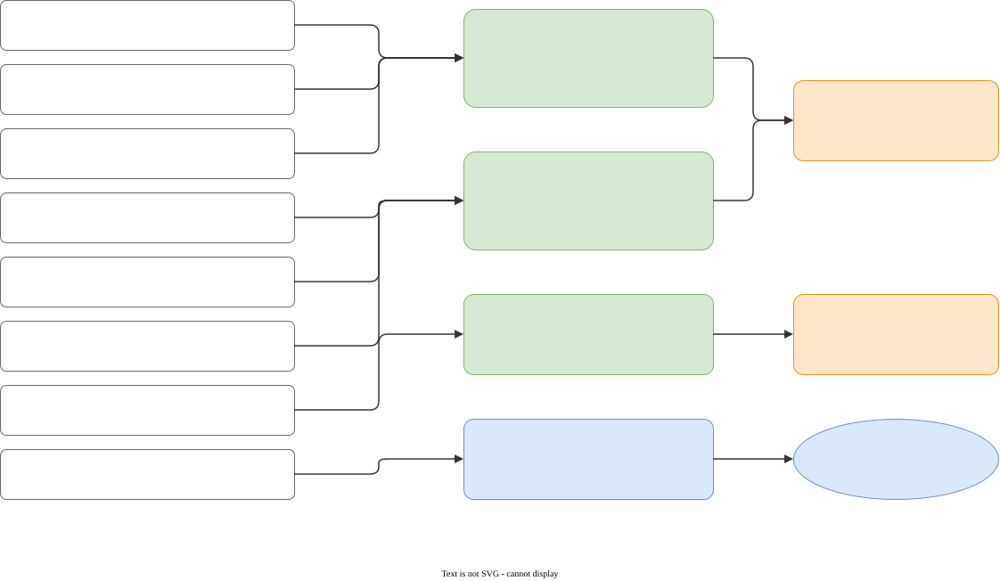

# Architecture

## Roles
- **Director**: Claude Code with the `/studio` skill (`skill/studio/SKILL.md`). Turns a brief into `PLAN.md` (small
  steps, each with a mechanical check), delegates steps, reviews (runs the check, reads the diff, looks at rendered
  frames), retries once with a sharper prompt or a different model, takes over when a step type keeps failing, keeps
  the ledger and commits. It can run on Claude (`claude`) or on a local model (`claude-local`).
- **Workers**: Claude Code processes started by `bin/studio-worker` (or the eval harness) on one step each, inside a
  sandbox confined to the project. The model is a local llama-swap model (via `claude-local`) or a Claude model
  (`claude --model claude-...`). Which model does which step type comes from `~/.config/studio/routing.json`
  (written from the hardware profile; measured values in `skill/studio/routing.json`).
- **Broker**: `bin/studio-broker`, a user service. Workers can't run engines or touch GPUs; they ask the broker with
  `studio <action> ...` (a JSON request file in the project's `.studio/spool/`). The broker runs only the actions it
  knows (Unreal Python/render/build/package/play, Blender, encode, Godot check/script/import/play/movie/export, run a
  packaged build), only on paths inside a registered project, logs to `.studio/logs/` and returns a filtered summary.

## GPUs
One GPU is the **worker GPU** (the local LLM). Rendering needs GPU memory too, so with `STUDIO_GPU_POLICY=timeshare`
the broker unloads the worker LLM for GPU jobs (Unreal renders, Blender GPU renders) and the next worker request
reloads it. That reload re-reads the worker's whole context (60-100K tokens: 2-4 minutes), so frequent GPU jobs are
expensive. With a second, smaller GPU, Godot jobs render there (`STUDIO_GODOT_ON_SMALL_GPU=1`) and never unload the
worker; Godot game logic can also run `--headless` without any GPU.

## Projects
`studio-new <Name> [--cpp | --godot]` creates a project from `template/` with git (+ LFS for binary assets), the
worker guide as `AGENTS.md`, `.studio/` (spool, logs, ledger) and registers it with the broker. Godot projects also
get `godot-ref/`, the version-matched reference bundle (API, manual, demo projects, cookbook) that sandboxed workers
search instead of trusting their (often outdated) memory.

## Ledger
`.studio/ledger.jsonl` records every worker attempt (model, time, turns, context, diff) and every verdict;
`studio-ledger <project> summary` reports how much was done locally vs by the director.

## Configuration
Everything machine-specific is in `~/.config/studio/studio.env` (`studio-config` prints it): project and model
folders, engine paths, GPU indices (CUDA and Vulkan numbering can differ), which models live on which GPU.
`install.sh` writes it from the detected hardware; edit it freely.

## Diagrams
The diagrams in `docs/diagrams/` are `.drawio.svg` files: GitHub shows them as images, and draw.io (desktop app,
app.diagrams.net or the VS Code extension) opens them for editing with the diagram embedded. Colours: yellow = you,
blue = Claude, green = local models and workers, purple = broker and engines, red = checks, orange = GPUs, grey =
files; dashed = planned. The step-by-step flow is in [workflow](workflow.md).
