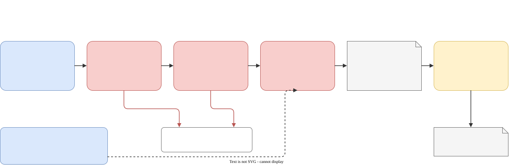

# Evals

Model choices in this repo come from measurements, and you can rerun them for your own models and hardware.

## Evaluating new models



New models are picked from public releases, but they win or lose on this suite. A candidate that fits a GPU slot is
added to `models/catalog.json` and smoke-tested (loads, calls tools, sees images). Then it gets a quick screen
against the model currently in that slot, and only if it comes close, the full suite with 2 runs per task and the
current model re-run on the same tooling, since tooling changes move scores too. The scorecard ends with a
recommendation; routing changes only when you approve it.

## Capability suite
`evals/harness.py` runs agent tasks (a worker in a sandboxed workspace, graded afterwards by hidden checks) and
direct tasks (a single API call: vision, long-context recall, log triage).

```sh
evals/harness.py list
evals/harness.py run --tasks 'godot_*' --models gemma4-26b-a4b,qwen3.6-35b-a3b --agents claude --reps 2
evals/harness.py run --tasks 'coding_*,ue_*' --models claude-sonnet-5-5 --agents claude      # online model
evals/harness.py report <run-dir>
evals/godot_scorecard.py <run-dir>          # Godot: scores + how each worker worked + clip contact sheet
```

Runs are resumable (finished runs are skipped); `touch <runs>/PAUSE` stops cleanly before the next run. Every
grader is validated against a reference solution (and a broken one) before models are measured: a test that a
correct solution can't pass, or a wrong one can, measures nothing.

| area | tasks |
|---|---|
| coding | bug fix with hidden tests, feature, C++ library |
| Unreal | scene, sequence, C++ actor, render via the broker |
| Blender/media | model a prop, ffmpeg edit, procedural audio |
| Godot | port Godot 3 -> 4, race logic vs hidden tests, platformer + exports (exported build must finish), Movie Maker clip |
| vision / long context / triage | exposure and defect judgement on frames, recall at 24K-188K, Unreal log root causes |

Scorecards: `evals/scorecard-20261008.md` (capability suite), `evals/scorecard-godot-20261014.md` (Godot).
The vision test frames are synthetic (`evals/assets/make_vision_assets.py`: labels true by construction); the
2026-10-08 vision scores were measured on an earlier set of rendered frames.
Discussion: [models.md](models.md).

## Comparison clip
`evals/compare/neonclip.py` makes the same 10-second Unreal clip with 2-3 models from identical prompts
(`evals/compare/neonclip/`): 8 steps (textures, towers, import, city, sequence, look development, rain, score), each
checked mechanically, one automatic retry with the check output, no fixes by the director, then a mechanical final
render and a side-by-side video with per-step stats. It tests what the small suite can't: long multi-step production.

```sh
evals/compare/neonclip.py all qwen gemma bonsai      # hours per model; resumable
```
