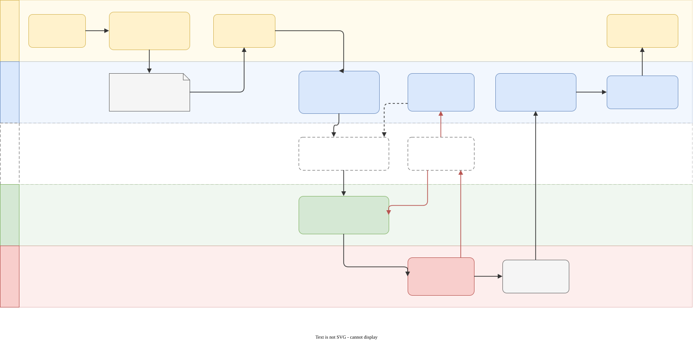
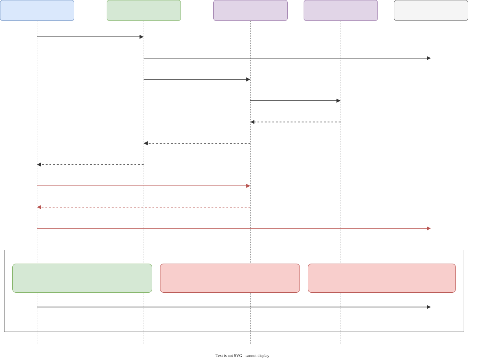

# Workflow: from idea to deliverable

Claude stays the director. Local models do the bulk, and they do best when each step is small, exact, and checked
by a machine. So the aim is to make the expensive, judgement-heavy part short and clear (the brief and the plan),
then run the long, mechanical part locally.

## 1. Sharpen the idea: `/grill-me` (optional, recommended for anything bigger than a clip)

A one-line idea leaves dozens of decisions open: genre, controls, camera, win/lose rules, art style, length,
platforms, what "done" means. A worker that hits an open decision guesses, and a guess made deep inside a step is
expensive to undo. The `/grill-me` skill settles those decisions before any work starts. It's an interview that
maps the idea as a tree of decisions, then works through it in rounds:

- each round asks every question that can be answered *now* (whatever depends on an open answer waits for a later
  round), numbered, with a recommended answer, so "yes" accepts it;
- facts are looked up, not asked: the director checks the tools, the engine version or the project itself;
- it ends when nothing is left open, and nothing is built until you confirm you agree.

The result is `BRIEF.md` in the project: the deliverable spec plus every settled decision. `/grill-with-docs` does
the same and also writes decision records (ADRs) and a glossary as it goes. That's useful for longer projects
where later steps need to know *why* something was decided.

**Install** (third-party skills, from [mattpocock/skills](https://github.com/mattpocock/skills), e.g. with
`npx skills add mattpocock/skills`): `/grill-me` calls the `grilling` skill, and `/grill-with-docs` also calls
`domain-modeling`. Install all of them. Claude Code reads skills from `~/.claude/skills/`; if an installer puts
them in `~/.agents/skills/`, link them over (`ln -s ~/.agents/skills/grilling ~/.claude/skills/`). Skills added
during a session show up after a restart.

## 2. Brief to plan: a task graph of tickets

The director turns the brief into `PLAN.md`: small steps ("tickets"), each with

- the exact files it touches and the tested helpers to use (workers are weak at spatial maths: prescribe
  `su.wall_panel`, `su.face_point`, cookbook recipes instead of letting them derive geometry);
- an **acceptance check** a machine can run: unit tests, `studio godot-check`, a headless autopilot run that must
  log `GAME_` markers, frame statistics of a render;
- its dependencies, and a size one worker finishes in under ~20 minutes.

## 3. Execution: one ticket at a time

The worker sees only its ticket and the project folder. It never sees the conversation, the graders or other
projects. It reaches engines and GPUs only through the broker. Its "done" is a claim. The director re-runs the
check itself, reads the diff and looks at the frames before it accepts anything. Every attempt, failed ones
included, goes into the ledger.

**Today** the director runs this loop itself. **Planned** (dashed in the diagram above): a plain dispatcher script
runs ready tickets in dependency order on the local worker, makes 2-3 attempts per ticket (local tokens are free),
commits what passes, and escalates only tickets that failed every attempt. Claude then spends its tokens on the
brief, the plan, escalations and milestone reviews, not on watching each step. The first pilot is a small Godot game.

## 4. Review and delivery

At each milestone the director does what checks can't: watches the render, plays the build, makes the creative
calls. Delivery is the mp4 or packaged game, plus a report from the ledger of what was done locally, what was
retried, and what the director did itself.

See also: [architecture](architecture.md) (components and sandbox), [models](models.md) (who does what, and why).
